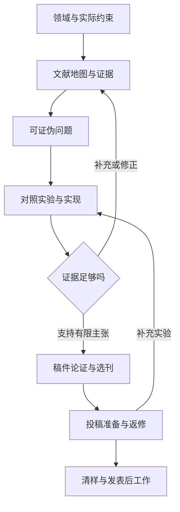

# ScholarRoute · 研途

**从一个研究领域，到有证据的研究问题、可复现实验和投稿路线。**

ScholarRoute 是面向研究型 Agent 的统一技能。给它一个领域、一份研究笔记、一个 Agent 程序或一篇稿件，它会按**领域、贡献类型和当前阶段**组合所需流程，持续保存文献、主张、实验、期刊事实和决策记录。重点支持 **LLM Agent 能力研究、Agent 程序与系统研究，以及费用敏感的期刊选择**。

[English](README.en.md) · [技能入口](skills/scholar-route/SKILL.md) · [来源审计](docs/source-audit.md) · [冲突规则](skills/scholar-route/references/conflicts.md) · [测试报告](docs/VALIDATION.md)

## 这一版包含什么

| 范围 | v1.0.0 内容 |
|---|---|
| 领域路由 | 8 个领域配置，可组合用于交叉研究 |
| 工作流 | 41 项能力模块，覆盖探索、实验、选刊、写作、投稿、返修与发表后工作 |
| 参考来源 | 17 个现行公开仓库，139 条来源能力映射，固定到完整提交 SHA |
| 冲突整理 | 33 条有明确处理方式的冲突规则 |
| 原生论文接口 | OpenAlex、Crossref、DBLP、arXiv 共 4 个受限检索适配器 |
| 原生本地工具 | 路由、证据账本、版本历史、事实冲突、约束筛选、报告与引用导出 |
| 运行要求 | Python 3.11+；核心只使用标准库 |

这里的 **139 条映射包括上游技能、子模式和领域变体**，不是 139 个已安装或已运行的独立插件。能力由本项目重新编写并统一组织；不需要先安装全部上游仓库。逐项出处和实际检查深度见[来源审计](docs/source-audit.md)。

“完整探索”表示覆盖相关研究流程，并明确检索范围、证据缺口和下一步。它不能证明某个领域已经被穷尽，也不会把计划中的实验写成完成结果。

## 快速开始

### 1. 获取和检查

```bash
git clone https://github.com/PresleyRen/scholar-route.git
cd scholar-route
python tests/run.py
python tools/validate_package.py
python skills/scholar-route/scripts/scholar_route.py doctor
```

无须安装 Python 第三方依赖。运行实际检索需要可访问相应 API；模型训练、数据分析、文档编译等使用宿主已经提供的工具。

### 2. 作为技能使用

安装目录是 `skills/scholar-route/`，其中 `SKILL.md` 是唯一入口。支持本地技能的宿主可以直接读取该入口，或通过自己的技能安装器从此仓库安装这个目录。

对于 Codex CLI / IDE，可将此目录放到目标项目的 `.agents/skills/scholar-route/`，或个人的 `~/.agents/skills/scholar-route/`。目标有同名技能时，先比较版本，再选择更新位置。位置与调用方式依据 [OpenAI 官方技能文档](https://learn.chatgpt.com/docs/build-skills)，核对日期为 2026-10-20；其他宿主以其说明为准。

安装后，可以这样提问：

```text
用 $scholar-route 完整探索 LLM Agent 的长期记忆与错误恢复。
重点区分能力创新和程序/系统创新，先建立文献地图与竞争方法，
给出可证伪问题、等预算对照、消融和最小实验。
最后根据真实证据筛选 SCIE 期刊，优先无强制发表费用的路径。
中文讨论，论文段落用英文；持续更新已有项目，不编造实验结果。
```

ChatGPT 中已安装的技能可通过技能选择器或 `@` 选择；Codex CLI / IDE 可以使用 `$scholar-route`。**发布 GitHub 源码和 Release 不会自动把技能安装到每个宿主，也不等于已上架插件目录。**

### 3. 直接运行本地工具

```bash
python skills/scholar-route/scripts/scholar_route.py route \
  --topic "LLM Agent memory and recovery" \
  --domains agent-ai,computer-science --stage full

python skills/scholar-route/scripts/scholar_route.py init \
  --project ./work/agent-memory \
  --topic "LLM Agent memory and recovery" \
  --domains agent-ai,computer-science --language zh-CN

python skills/scholar-route/scripts/scholar_route.py search \
  --provider openalex --query "language agent memory" \
  --limit 5 --project ./work/agent-memory

python skills/scholar-route/scripts/scholar_route.py validate \
  --project ./work/agent-memory

python skills/scholar-route/scripts/scholar_route.py report \
  --project ./work/agent-memory
```

离线试用使用原创合成数据，不涉及真实期刊推荐：

```bash
python examples/run_demo.py --project ./work/demo
```

实际记录和费用约束的 JSON 示例见[数据契约](skills/scholar-route/references/data-contracts.md)和[记录示例](skills/scholar-route/references/record-examples.md)。

## 怎样完成一个领域的探索

技能先判定贡献属于方法/能力、系统/程序、基准评测、领域应用或人机研究，然后组合领域规则。默认按需读取参考模块；要求全流程时，规划全部相关阶段并完成当前条件允许的工作。



每个阶段都应交付能继续使用的内容：查询和筛选记录、论文笔记、研究地图、假设与反证、实验协议、实际运行记录、期刊证据表、稿件审查或回复稿。未获得全文、未执行实验、未核验费用、未发送投稿都保持明确的未完成状态。

### 领域配置

<!-- DOMAINS:START -->

| 配置 ID | 领域 | 首选来源路线（原生与宿主来源合并列示） |
|---|---|---|
| `agent-ai` | LLM Agent 能力与系统 | OpenAlex、DBLP、arXiv、Semantic Scholar、Crossref、Hugging Face Papers |
| `computer-science` | 计算机、软件工程与 NLP | DBLP、OpenAlex、arXiv、Semantic Scholar、Crossref、ACM Digital Library、IEEE Xplore |
| `engineering` | 工程、控制与应用 AI | OpenAlex、Crossref、IEEE Xplore、Scopus |
| `biomedicine` | 生物、医学与公共健康 | PubMed、PMC、Europe PMC、bioRxiv、medRxiv、OpenAlex、Crossref |
| `social-sciences` | 社会科学、心理、教育与 HCI | OpenAlex、Crossref、Semantic Scholar、Scopus、Web of Science、ERIC |
| `food-agriculture` | 食品、营养与农业 | PubMed、OpenAlex、Crossref、AGRICOLA |
| `humanities` | 人文、历史与哲学 | OpenAlex、Crossref、JSTOR、disciplinary bibliographies |
| `general` | 通用领域自适应 | OpenAlex、Crossref、Semantic Scholar、DOAJ |

<!-- DOMAINS:END -->

领域关键词只是初始建议，可以通过 `--domains` 明确指定。医学文献问答 Agent 可组合 `agent-ai,computer-science,biomedicine`，但是否需要临床试验规范取决于实际研究设计。会议论文可以作为计算机领域的重要文献证据；要求 SCI 期刊时，会议不能进入期刊投稿候选。

地区规则独立设置：`--region international`、`china` 或 `turkey`。中文目录、CNKI/万方/维普、NPPA、TR Dizin/DergiPark 等是有条件的来源路线，不是全部内置 API。

## 41 项能力详情

下表解释实际覆盖内容。全部模块的输入、输出、边界和对应来源见[能力注册表](skills/scholar-route/references/capabilities.md)与[逐项来源映射](docs/source-audit.md)。

<!-- CAPABILITIES:START -->

| 能力 ID | 能力 | 具体产物与边界 |
|---|---|---|
| `intake` | [目标、证据与限制](skills/scholar-route/references/data-contracts.md) | 整理研究对象、贡献类型、稿件阶段、语言、数据与预算；复用用户已给出的条件。 |
| `field-map` | [领域结构与研究地图](skills/scholar-route/references/exploration.md) | 从综述和原始论文建立问题—方法—证据—局限地图，标出覆盖边界与未探索区域。 |
| `search-protocol` | [检索协议与多语言查询](skills/scholar-route/references/exploration.md) | 生成中英文同义词、分库查询、时间范围、筛选标准和可重现的检索日志。 |
| `paper-search` | [论文与开放科研资源检索](skills/scholar-route/references/sources-and-tools.md) | 通过四个原生适配器和可用宿主来源召回论文；记录失败、截断和访问状态。 |
| `identifier-check` | [DOI、ISSN、版本与元数据校验](skills/scholar-route/references/data-contracts.md) | 检查 DOI/ISSN 格式、版本与引文身份；来源内容核实由宿主完成。 |
| `evidence-review` | [筛选、提取、质量与证据综合](skills/scholar-route/references/exploration.md) | 筛选、数据提取、研究设计评价、叙述/范围/系统综述和可比较性检查。 |
| `paper-notes` | [精读、笔记与主张关联](skills/scholar-route/references/exploration.md) | 精读方法、假设、数据、结果、局限与代码，连接到具体主张。 |
| `novelty-audit` | [新颖性、反证与研究空白](skills/scholar-route/references/exploration.md) | 检索最近竞争者、相邻领域和经典方法，核实差异并寻找会推翻创新主张的基线。 |
| `hypothesis-plan` | [可证伪假设与可行性](skills/scholar-route/references/exploration.md) | 提出可证伪问题、机制解释、可行性与最小验证实验；支持研究计划书。 |
| `agent-capabilities` | [Agent 能力拆解与评测](skills/scholar-route/references/agent-research.md) | 覆盖意图、路由、规划、工具、RAG、记忆、验证、反思、协作、长任务等 14 类能力。 |
| `agent-systems` | [Agent 程序、架构与运行实验](skills/scholar-route/references/agent-research.md) | 检查状态控制、接口、隔离、调度、恢复、存储、观测和部署 8 个程序层。 |
| `experiment-plan` | [实验设计与效度](skills/scholar-route/references/exploration.md) | 把主张变成变量、对照、消融、指标、样本、停止条件和反证实验。 |
| `statistics-robustness` | [统计、稳健性与不确定性](skills/scholar-route/references/publication.md) | 审查统计单位、依赖、混杂、泄漏、多重比较、不确定性与稳健性；有数据工具才实际计算。 |
| `implementation` | [复现、代码实现与执行记录](skills/scholar-route/references/agent-research.md) | 读代码、复现基线、实现最小机制、控制预算、记录实际命令和运行结果；使用宿主执行工具。 |
| `data-collection` | [数据计划、出处与再利用](skills/scholar-route/references/exploration.md) | 规划数据来源、许可、采样、版本、质量、拆分与复用条件。 |
| `state-map` | [项目记录、关系图与断点恢复](skills/scholar-route/references/data-contracts.md) | 保存八类证据实体、历史版本与关系；恢复项目，导出报告、Mermaid 图和 BibTeX。 |
| `manuscript-profile` | [稿件画像与贡献类型](skills/scholar-route/references/journal-selection.md) | 提炼问题、贡献、方法角色、证据、读者、文章类型和选刊限制。 |
| `venue-discovery` | [多来源期刊与候选召回](skills/scholar-route/references/journal-selection.md) | 相似论文、专业刊、出版商匹配器、目录与可选本地索引互补召回。 |
| `venue-identity` | [期刊/会议身份与 ISSN](skills/scholar-route/references/journal-selection.md) | 核对期刊名称、ISSN、出版社、官方入口、改名及期刊/会议差异。 |
| `journal-dossier` | [单刊全景与作者指南](skills/scholar-route/references/journal-selection.md) | 完整调查单刊的范围、近刊先例、要求、费用、时效、政策和未知项。 |
| `indexing-metrics` | [索引、分区、年份与类别](skills/scholar-route/references/journal-selection.md) | 核实 SCIE/SSCI/ESCI 等索引，分开保存 JCR/SJR/CAS 的年度与类别。 |
| `costs-timelines` | [费用路径与审稿时间定义](skills/scholar-route/references/journal-selection.md) | 区分强制费用/可选 OA/减免条件，以及初审、外审、录用和发表时间。 |
| `journal-integrity` | [出版透明度与风险证据](skills/scholar-route/references/journal-selection.md) | 核查身份与政策透明度，记录具体风险证据；不靠 OA 缺失或低价格贴标签。 |
| `fit-comparison` | [适配、证据与三态筛选](skills/scholar-route/references/journal-selection.md) | 保留符合、待核实、排除三类候选，把适配判断与证据覆盖分开。 |
| `submission-plan` | [可解释投稿顺序](skills/scholar-route/references/journal-selection.md) | 按范围、证据和实际约束解释投稿顺序，列出改进与改投条件。 |
| `argument-audit` | [论证与实验叙事重构](skills/scholar-route/references/publication.md) | 重建问题、机制、结果和结论的证据关系，指出跳步、过度主张和缺少比较。 |
| `manuscript-writing` | [科学写作、润色与数值保真](skills/scholar-route/references/publication.md) | 中文/英文科学写作与润色，保留数字、术语、TeX 与引用；支持提案文本。 |
| `citation-audit` | [引文、BibTeX 与引用支持](skills/scholar-route/references/publication.md) | 核实引用身份、版本、位置与内容支持，整理引用元数据和 BibTeX。 |
| `figure-table-audit` | [图表、单位与可视化检查](skills/scholar-route/references/publication.md) | 核对图表数据、单位、样本数、标注、可读性和期刊要求；实际编辑依赖宿主绘图工具。 |
| `peer-review` | [分角色审稿与异议归并](skills/scholar-route/references/publication.md) | 以互补视角模拟严格审稿，归并异议和可执行修改，不预测真实编辑决定。 |
| `venue-formatting` | [期刊模板、改投与排版](skills/scholar-route/references/publication.md) | 读取当前文章类型/阶段要求，改投重排、检查模板并通过宿主编译/渲染。 |
| `cover-letter` | [投稿信](skills/scholar-route/references/publication.md) | 依据真实贡献与期刊范围写投稿信，保留未确认声明。 |
| `presubmission-inquiry` | [投稿前询问信](skills/scholar-route/references/publication.md) | 草拟有针对性的投稿前询问信；仅在已有授权范围内发送。 |
| `reviewer-discovery` | [审稿人候选与利益冲突](skills/scholar-route/references/publication.md) | 通过文献核实候选专长、身份与适用利益冲突，不编造邮箱或同意。 |
| `authorship-credit` | [署名、CRediT 与声明核实](skills/scholar-route/references/publication.md) | 收集实际贡献，协助 CRediT 与署名声明，标出需要作者决定的内容。 |
| `submission-preflight` | [Quick/Full 投稿预检](skills/scholar-route/references/publication.md) | Quick/Full 预检稿件、图表、声明、附件、数据代码与投稿要求。 |
| `revision-response` | [逐条返修与修改定位](skills/scholar-route/references/publication.md) | 逐条拆解审稿意见，连接回复、真实改动与定位，支持有依据的异议/申诉。 |
| `proof-check` | [清样核对](skills/scholar-route/references/publication.md) | 比对录用稿和清样的文字、数值、公式、作者信息、参考文献与排版变化。 |
| `dissemination` | [发表后传播与公开材料](skills/scholar-route/references/publication.md) | 基于已发表证据草拟摘要、海报/可编辑展示材料和传播内容；导出依赖宿主。 |
| `postpublication-correction` | [更正与发表后问题处理](skills/scholar-route/references/publication.md) | 整理错误、影响范围和证据，草拟按期刊政策处理的更正沟通。 |
| `regional-indexing` | [中文/土耳其期刊与目录](skills/scholar-route/references/domains.md) | 条件调用中文目录、NPPA、CNKI/万方/维普，以及 TR Dizin/DergiPark 路由。 |

<!-- CAPABILITIES:END -->

## Agent 研究的专项覆盖

### 能力研究：14 个能力族

| 能力族 | 主要研究角度 |
|---|---|
| 意图与任务定义 | 歧义消解、约束保持、成功判据 |
| 路由与委派 | 模型、工具、角色选择，拒绝与升级机制 |
| 规划与分解 | 长短程规划、搜索、重规划与反应式执行 |
| 工具使用 | 选择、参数、顺序、输出解释与契约错误 |
| 检索与依据 | RAG、混合检索、重排、引用和证据利用 |
| 记忆与上下文 | 存储、更新、遗忘、过时知识、来源与会话隔离 |
| 推理与验证 | 有效检查、错误发现、误拒和虚假信心 |
| 反思与适应 | 反馈改变机制、持久收益、与简单重试的比较 |
| 多 Agent 协作 | 强单 Agent、同预算集成、通信结构与冲突处理 |
| 长任务执行 | 状态保持、中断恢复、依赖与停止行为 |
| 学习与优化 | 参数、策略、提示优化，调优与评测拆分 |
| 多模态与具身行为 | 感知不确定性、动作反馈与仿真/真实差异 |
| 人类监督 | 介入时机、质量、人力成本和协作效果 |
| 可靠性与误用抵抗 | 不可信输入、权限边界、数据隔离与安全失败 |

### 程序研究：8 个系统层

覆盖 **控制器/状态、工具接口、执行隔离、调度、恢复、记忆/存储、可观测性、部署/复现**。会检查实际代码与代表性轨迹，把架构选择关联到工作负载要求、替代设计和可推翻该设计的实验。

例如，“增加多个 Agent”需要与强单 Agent、同总 token/调用预算、顺序集成进行比较；“记忆更可靠”需要测试过期、冲突、跨任务污染和回收；“恢复更好”需要测中断、重试、幂等性、重复副作用与最终任务结果。具体协议见 [Agent 研究指南](skills/scholar-route/references/agent-research.md)。

## 选刊如何判断“相对好投”

本技能把这个要求转为可核验的问题：**是否符合范围和文章类型、是否有真正可比的近期论文、稿件证据能否支撑贡献、费用和时间条件是否可接受、哪些退稿风险能通过修改降低**。投稿顺序可以使用“冲刺 / 主投 / 备选”作为策略标签，但不会产生个人录用概率或保证录用。

| 候选池 | 进入条件 | 后续行动 |
|---|---|---|
| `eligible` 符合记录条件 | 已记录且符合全部硬约束 | 继续人工核实科学适配与具体投稿路线 |
| `unverified` 待核实 | 没有已知违反，但至少一个决定性事实缺失、过时、冲突或证据不满足要求 | 明确指出缺失字段和核验任务 |
| `excluded` 排除 | 至少一个已核实事实违反硬约束 | 保留原候选、原因和其余未知项 |

`eligible` 只说明当前记录满足代码规则，不证明外部来源真实支持该事实。可选的 0–5 适配分是带依据的人工判断，与资格、证据覆盖、分区和录用机会分别处理。展示短名单默认同出版社最多两本；未知出版社共同归组，其他候选仍保留。

对于费用敏感研究，必须核实具体发表路径。可选 OA 不等于必须支付 APC；有条件减免不等于确定免费；APC 为零也不能忽略强制版面、彩图或投稿费。不同货币的非零费用不做隐含换算。动态事实在实际决策前重新核验。

## 冲突怎样统一

所有适用能力通过统一的证据标准、数据契约和阶段接口协作。明显冲突的默认值改为领域条件或用户参数。完整规则见 [CF01–CF33](skills/scholar-route/references/conflicts.md)。

| 原有做法之间的冲突 | ScholarRoute 的处理 |
|---|---|
| 固定推荐数量、录用率分桶、所谓保底刊 | 依据证据解释顺序；不足数量如实交付，不捏造概率 |
| JCR、SJR、中科院分区混用；WoS 被当作 SCIE | 保存体系、年份、类别和负责机构证据，分开筛选 |
| 未知费用当零、缺字段直接删除候选 | 三态筛选，保留未知和缺口；费用记录完整强制成本与适用条件 |
| 初审、外审、录用、发表时间混为一谈 | 每个时间字段保存端点、统计口径与观察期 |
| 医学数据库和固定时间窗强制用于所有学科 | 按领域组合来源，说明查询边界；方法学标准依实际设计选择 |
| 单一出版商偏好、以命中文章数量代表匹配 | 多来源召回、比较真实论文、控制展示集中度 |
| 只有 DOI 或摘要就声称全文核验 | 保存阅读深度和版本；引用身份与内容支持分别核实 |
| 多角色意见被当作独立专家证据 | 标注模拟审查，归并异议；不通过投票预测编辑决定 |
| 计划、演示或静态检查被当作真实实验 | 分别记录 proposed/planned/running/completed 与实际命令结果 |
| 不同模块反复询问、覆盖已有项目 | 复用授权与上下文、追加历史；仅对真正阻塞的决定提问 |
| 上游专有数据库、模板或缺失许可证 | 独立实现通用能力，记录出处；不复制受限制材料 |
| 列出外部工具就声称全自动集成 | 标明原生、宿主执行和可选依赖三种执行方式 |

## 哪些功能是可执行代码

| 执行方式 | v1.0.0 的具体实现 |
|---|---|
| **原生 Python** | 领域/阶段路由、JSON 证据记录、DOI 规范化、ISSN 校验、关系和历史检查、事实冲突、费用/索引等约束评估、四个论文检索适配器、五类报告导出 |
| **宿主 Agent 工作流** | 真实阅读、科学判断、研究问题设计、代码实现、运行实验、统计分析、论文写作、审稿和投稿材料准备；需要宿主对应工具与数据 |
| **可选外部集成** | PubMed/PMC、Semantic Scholar、HF Papers、WoS/Scopus/DOAJ、出版商匹配器、地区目录、HF 数据/训练/评测/跟踪、Word/PDF/LaTeX/图表等；使用实际可用且适用的工具 |

本项目不内置 GPU 训练系统、FAISS 全量期刊索引、浏览器代理、全文订阅访问、自动编辑部通信或一键投稿服务。没有对应工具时，交付可继续执行的计划和明确的依赖；不会把工具不可用表述成任务已完成。相关接口依据和访问限制见[来源与工具](skills/scholar-route/references/sources-and-tools.md)及 [API 契约](skills/scholar-route/references/sources-api.md)。

### CLI 命令

| 命令 | 用途 |
|---|---|
| `route` | 根据主题、领域、地区和阶段返回模块路线 |
| `init` | 创建或恢复同一主题项目 |
| `record` | 登记 source/paper/journal/claim/hypothesis/experiment/decision/search |
| `constraints` | 合并更新选刊限制，未给出的字段保持不变 |
| `resolve` | 用来源与理由解决当前待审事实冲突 |
| `search` | 运行一个原生论文查询，可原子导入已创建项目 |
| `import-search` | 原子导入已保存的原生查询结果包 |
| `assess` | 分池并生成可解释的候选评估 |
| `validate` | 检查记录结构、身份、关系、日期、数值与历史 |
| `report` | 从当前项目生成报告，不增加项目修订号 |
| `capabilities` / `doctor` | 查看能力注册表和本地环境依赖 |

原生检索每次只读受限第一页，默认不声称完整检索；单次上限 100 条、响应上限 2 MiB、超时范围 1–60 秒。分页穷尽、科学筛选和全文阅读属于后续工作。HTTP 200 但响应结构错误仍会失败；接口失败不会变成“未找到相关论文”。原生导入保留预印本身份与版本，不因关联期刊 DOI 自动升级为正式期刊文章。

## 项目保存和交付

`project.json` 保存八类实体、稳定项目 ID、UTC 时间、修订号、关联关系和逐次历史。局部修改采用锁与原子替换；同一记录无变化时不产生虚假修订。事实变更保留旧证据；费用的货币、条件和完整性改变也会进入冲突审查。

网络来源记录 URL、检索日期与已审查状态；**本地证据可以记录路径与 SHA-256，无须虚构网页地址**。哈希用于标识记录的文件版本，不证明科学结论，也不会自动归档文件。

`report` 生成：

| 文件 | 内容 |
|---|---|
| `REPORT.md` | 约束、证据、候选、主张、未知项和项目状态 |
| `MAP.md` | 已记录实体关系的 Mermaid 图与清单；大图只展示前 60 条边并明确限制 |
| `journals.csv` | 含筛选状态的期刊/投稿候选表，处理表格公式注入 |
| `references.bib` | 按记录类型导出的 BibTeX |
| `assessment.json` | 可供后续工具读取的约束评估 |

详细协议、预算和替代解释可以保存在实体的 `notes` 中；确定性报告不会展开全部任意 `notes` 字段，完整内容仍在 `project.json`，宿主据此编写研究方案。

v1 的确定性报告标签为中文。项目语言用于指导宿主写作，CLI 不会自动翻译论文内容。实际研究项目应保存在独立的项目位置；本公开技能仓库只包含原创说明、代码和明确标注的合成示例。

## 来源与许可

下列来源在 **2026-10-20** 核验。全部 41 项能力均可追溯到相关来源映射；每条映射记录参考提交、文件证据、检查深度、整合方式和未采用内容。大型来源只审计相关研究/发表模块，未声称逐文件执行其整个生态。

<!-- SOURCES:START -->

| 来源仓库 | 映射条目 | 参考提交 | 许可证声明 |
|---|---:|---|---|
| [zero565656/journal-recommender](https://github.com/zero565656/journal-recommender) | 1 | [407aff1066](https://github.com/zero565656/journal-recommender/commit/407aff106677aac090bf2d177155db15e3593126) | 未发现许可证 |
| [kkunkunya/journal-research-agent-plugins](https://github.com/kkunkunya/journal-research-agent-plugins) | 17 | [d902e4cb07](https://github.com/kkunkunya/journal-research-agent-plugins/commit/d902e4cb07443f079cbb5085f2de2820a1a09f79) | MIT |
| [keros68/xiaoyu-skill](https://github.com/keros68/xiaoyu-skill) | 4 | [d8b26a741b](https://github.com/keros68/xiaoyu-skill/commit/d8b26a741beae6d474db08f9fe8bc857f0490a95) | MIT |
| [huangwb8/ChineseResearchLaTeX](https://github.com/huangwb8/ChineseResearchLaTeX) | 2 | [d288ea832e](https://github.com/huangwb8/ChineseResearchLaTeX/commit/d288ea832e4b2ffca5a0cca97576d3413391a342) | MIT |
| [hztopcu/journal-fit-finder](https://github.com/hztopcu/journal-fit-finder) | 1 | [2624d0b40a](https://github.com/hztopcu/journal-fit-finder/commit/2624d0b40a444951157c626c01bda73c65c60b23) | MIT |
| [yujie-jason-zhang/polish_skill](https://github.com/yujie-jason-zhang/polish_skill) | 9 | [9b2a86ca6a](https://github.com/yujie-jason-zhang/polish_skill/commit/9b2a86ca6ac88879a3d3490fecdb909673fd1562) | MIT |
| [yaotingsun/academic-publishing-skills](https://github.com/yaotingsun/academic-publishing-skills) | 18 | [3103f4d7d4](https://github.com/yaotingsun/academic-publishing-skills/commit/3103f4d7d4a97fc3bf80a61ce4cb04dd21d4d88e) | Apache-2.0 |
| [regisely/superpapers](https://github.com/regisely/superpapers) | 16 | [805a9a7369](https://github.com/regisely/superpapers/commit/805a9a7369d57f01b67732645175ad0b7a8a3f23) | MIT |
| [sokolmarek/researcher](https://github.com/sokolmarek/researcher) | 35 | [e4ddbf4eb8](https://github.com/sokolmarek/researcher/commit/e4ddbf4eb8a93565a222c48797ed3e0dc6cf0945) | MIT |
| [K-Dense-AI/scientific-agent-skills](https://github.com/K-Dense-AI/scientific-agent-skills) | 7 | [593377bb04](https://github.com/K-Dense-AI/scientific-agent-skills/commit/593377bb048752abb0152deab9fbb1083a6087df) | MIT |
| [Orchestra-Research/AI-Research-SKILLs](https://github.com/Orchestra-Research/AI-Research-SKILLs) | 2 | [773a52944b](https://github.com/Orchestra-Research/AI-Research-SKILLs/commit/773a52944ba4747a18bd4ae9ade53fff041adcbc) | MIT |
| [Zaious/journal-atlas](https://github.com/Zaious/journal-atlas) | 2 | [574d27d84c](https://github.com/Zaious/journal-atlas/commit/574d27d84c270fc8da16df69d9bad929e5c341e0) | CC-BY-SA-4.0 content; MIT scripts |
| [alexishuang1901-hub/journal-finder](https://github.com/alexishuang1901-hub/journal-finder) | 2 | [b8fb764bc4](https://github.com/alexishuang1901-hub/journal-finder/commit/b8fb764bc4b60acb88538e579b165bf4745b3072) | MIT |
| [yibeixiaobai/journal-selector](https://github.com/yibeixiaobai/journal-selector) | 1 | [b5303f3531](https://github.com/yibeixiaobai/journal-selector/commit/b5303f35310500302e4f72381451dc6d2d433bc8) | 未发现许可证 |
| [brycewang-stanford/Awesome-Journal-Skills](https://github.com/brycewang-stanford/Awesome-Journal-Skills) | 7 | [932eb23331](https://github.com/brycewang-stanford/Awesome-Journal-Skills/commit/932eb23331721b16e967c59f093781be1928b498) | MIT |
| [PangenomeAI/academic-skills-food-nutrition](https://github.com/PangenomeAI/academic-skills-food-nutrition) | 10 | [01b2158a48](https://github.com/PangenomeAI/academic-skills-food-nutrition/commit/01b2158a48408a8d0e56238c04075080c793d53c) | MIT |
| [HosungYou/LongTable](https://github.com/HosungYou/LongTable) | 5 | [eed627a85f](https://github.com/HosungYou/LongTable/commit/eed627a85f0db7ea218beb56c61fde36c975a4e4) | MIT |

<!-- SOURCES:END -->

原始工作流、代码和文档以本仓库 [MIT License](LICENSE) 发布。上表只记录上游自身的许可证声明，不改变其条款；没有复制上游技能正文、程序、模板、数据库或论文全文。无许可证来源仅参考通用能力问题。详细记录位于 [source-audit.md](docs/source-audit.md) 和 [upstreams.json](skills/scholar-route/assets/upstreams.json)。

## 测试与可复核性

测试以虚构来源、临时项目和受控响应完成，不调用付费模型、不声称期刊推荐准确率或研究结论被实证验证。

- **89 项自动化回归通过**，覆盖项目生命周期、数据校验、身份/版本、事实冲突、硬约束、排序、导出、四个接口解析、错误响应、原子导入和本地证据。
- 全新 Agent 前向试跑覆盖期刊筛选、跨领域 Agent 研究规划和本地笔记证据登记；保留实际发现的问题与修复记录。
- 来源审计与包校验检查 41 项能力映射、17 个固定提交、引用路径和技能元数据。
- 四个真实 API 曾在当前执行环境试探；网络受限，均返回 `network_error`。因此**真实服务连通性未验证**，不能把离线接口测试称为在线通过。

确切测试数量、命令、试跑范围和后续 CI 状态见 [docs/VALIDATION.md](docs/VALIDATION.md)；原始网络结果在 [live-smoke.json](docs/live-smoke.json)。

## 扩展与维护

新增领域时，更新 `assets/domains.json` 与领域参考；新增能力时，更新 `assets/modules.json`、对应工作流和来源映射；新增接口时，提供成功、错误、空值、截断、身份保真和无密钥泄漏测试。外部期刊数据更新不能覆盖历史事实。

```bash
python tools/update_readme.py
python tools/validate_package.py
python tests/run.py
```

`update_readme.py` 只同步 README 中的领域、能力与来源表。它不会替代来源重新核验。提出改进时，请附领域、输入范围、复现命令、实际行为和期望行为；共享前去除未公开稿件、凭据和受限制数据。
